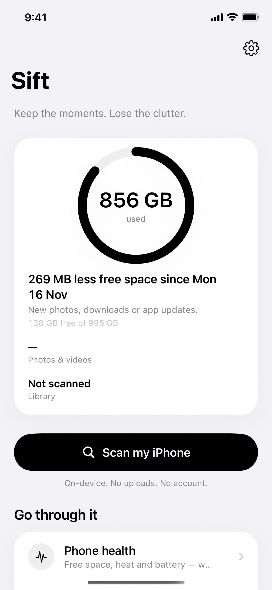

# Sift

**Keep the moments. Lose the clutter.**

Sift is a free, open-source iPhone cleaner. It finds screenshots, duplicates, near-duplicate shots, blurry photos, large videos and duplicate contacts — entirely on your iPhone.

[](LICENSE)
[](#requirements)
[](docs/PRIVACY.md)

**Website:** [modernamusements.github.io/sift](https://modernamusements.github.io/sift)

  

## Why another cleaner?

Commercial cleaners charge a subscription for a scan, gate the useful part, and sometimes ship analytics SDKs that see your library metadata. Sift is the opposite:

- **Free and open source.** MIT, no account, no ads, no subscription.
- **On-device only.** No networking code exists in the app. Your photos and contacts never leave the iPhone.
- **No fake features.** Sift cannot clear other apps' caches, "boost RAM", cool the CPU or extend battery life. iOS does not allow it, so we do not pretend.
- **Apple's safety net.** Every photo removal goes through PhotoKit and lands in **Recently Deleted** for 30 days.

## What it does

| Cleanup | How it works |
| --- | --- |
| **Screenshots** | Finds `PHAsset` screenshots, sorted by size, review and remove |
| **Duplicates** | 64-bit dHash + Vision feature print, grouped by exact dimensions |
| **Similar photos** | Feature-print distance within the same day; falls back to an on-device color mosaic when Vision is unavailable |
| **Blurry photos** | Variance-of-Laplacian ranking; conservative threshold |
| **Large videos** | Over 50 MB or one minute, sorted by size |
| **Duplicate contacts** | Shared phone/email handles, merge into the richest card |

Plus a fast **swipe review** deck, a live storage dashboard, and settings for scan sensitivity.

## Honest limits

- iOS does not let third-party apps delete another app's cache or system "other" storage. Sift does not claim to.
- Free space is only truly reclaimed after **Recently Deleted** is emptied in Photos (or after 30 days).
- Contacts have no Recently Deleted. Sift previews every merge and requires confirmation.
- Contact merging deletes the redundant cards from Contacts. If Contacts syncs to iCloud, that deletion syncs too.
- Vision feature prints are unavailable in some Simulator runtimes; the app automatically uses a local color-mosaic fallback. Physical devices use the stronger Vision path.
- The app is English-only in v1. Localisation contributions are welcome.

## Requirements

- Xcode 26 (tested) or newer
- iOS 17.0+ / an iPhone 12 or newer for the intended layout
- [XcodeGen](https://github.com/yonaskolb/XcodeGen): `brew install xcodegen`

## Build

```bash
git clone https://github.com/ModernAmusements/sift.git
cd sift
xcodegen generate
open Sift.xcodeproj
```

Select the **Sift** scheme and an iPhone 12 simulator (or your device). For a physical device, choose your development team in Signing & Capabilities. There are no package dependencies.

Command line:

```bash
xcodebuild -project Sift.xcodeproj -scheme Sift \
  -destination 'platform=iOS Simulator,name=iPhone 12' build
```

## Test

```bash
xcodebuild -project Sift.xcodeproj -scheme Sift \
  -destination 'platform=iOS Simulator,name=iPhone 12' test
```

The UI suite expects Photos/Contacts permission and the simulator fixtures:

```bash
./scripts/seed-simulator.sh "iPhone 12"
xcrun simctl privacy booted grant photos dev.modernamusement.sift
xcrun simctl privacy booted grant contacts dev.modernamusement.sift
```

The screenshot category uses a **DEBUG-only** fixture (`-uiFixtures`) because PhotoKit gives imported images no screenshot subtype. Production code reads `PHAsset.mediaSubtypes.contains(.photoScreenshot)`.

See [`docs/QA.md`](docs/QA.md) for the verified flow and evidence.

## Architecture

```
Sift/
  App/          entry point, onboarding gate
  Design/       theme, components, haptics
  Models/       ScannedAsset, ScanReport, storage snapshot
  Services/     PhotoKit, Vision, hashing, contacts, scan engine
  Features/     Home, Review, Similar, Swipe, Contacts, Settings
Tests/          unit + UI tests
docs/           product, design, architecture, research, privacy, QA
```

- SwiftUI, Swift 5 language mode, iOS 17.
- No third-party dependencies.
- `ScanEngine` runs a bounded analysis pipeline (4 thumbnails at a time) and is cancellable.
- All mutations go through PhotoKit or Contacts; files are never touched by path.

Read [`docs/ARCHITECTURE.md`](docs/ARCHITECTURE.md) for the algorithm thresholds and data flow.

## Privacy

Sift has no networking code, no analytics, no ads and no account system. The privacy manifest declares no tracking and no collected data. Read [`docs/PRIVACY.md`](docs/PRIVACY.md).

Verify it yourself:

```bash
grep -rnE "URLSession|URLRequest|NWConnection|WKWebView|Analytics|Firebase|Sentry" Sift
# no matches
```

## Contributing

Bug reports, design polish and localisation are welcome. Start with [`CONTRIBUTING.md`](CONTRIBUTING.md) and [`docs/DESIGN.md`](docs/DESIGN.md).

The agent harness used to build this repo lives in `opencode.json` and `.opencode/agents/`. It is optional for contributors.

## License

MIT — see [`LICENSE`](LICENSE).

Sift is not affiliated with Apple, CleanMyiPhone or any commercial cleaner. PhotoKit, Vision and Contacts are Apple frameworks.
